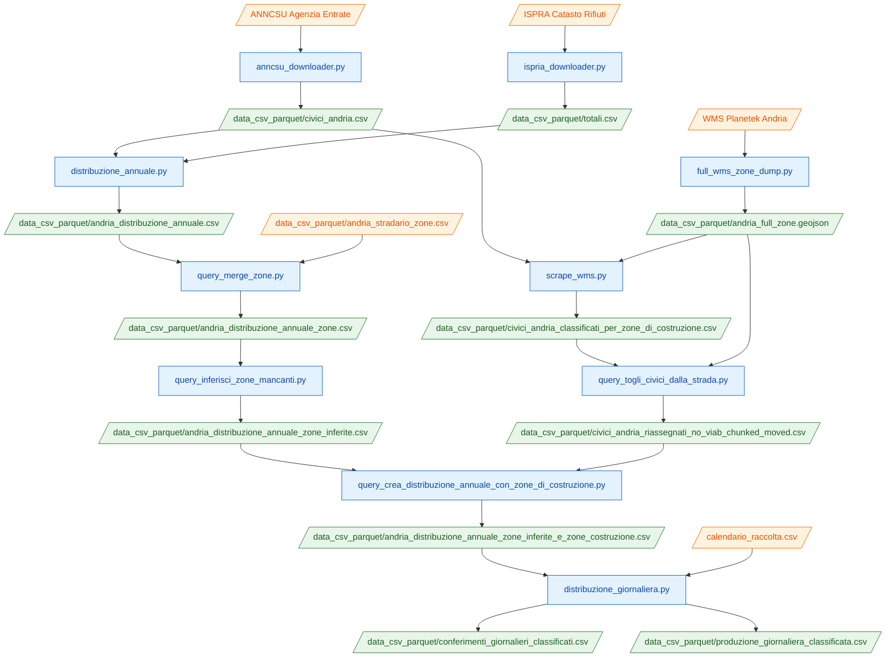

# Riepilogo

## ORDINE ESECUZIONE SCRIPT

Il modo consigliato per creare il dataset è il runner a grafo:

```bash
./run_pipeline.sh
```

Il runner usa `joblib` per eseguire in parallelo i task indipendenti e salta i task già aggiornati. Un task è considerato in cache quando tutti i file di output esistono in `data_csv_parquet` e sono più recenti dei suoi input.

PER ESEGUIRE: `JOBS=4 ANNO=2024 SEED=42 ./run_pipeline.sh`

Variabili utili:

```bash
JOBS=4 ./run_pipeline.sh      # numero di task paralleli
FORCE=1 ./run_pipeline.sh     # ignora la cache e rigenera tutto
ANNO=2024 ./run_pipeline.sh   # anno dei dati ISPRA e giornalieri
SEED=42 ./run_pipeline.sh     # seed deterministico
```

Per vedere i livelli del grafo senza eseguire:

```bash
python dataset/pipeline_graph.py --dry-run
```

Sequenza manuale equivalente, utile come riferimento:

il seed è sempre 42

1. recuperare lista civici: `python dataset/data_gathering/anncsu_downloader.py --out data_csv_parquet/civici_andria.csv`
2. recuperare totali: `python dataset/data_gathering/ispria_downloader.py --anno 2024 --out data_csv_parquet/totali.csv`
3. Distribuzione annua: `python dataset/distribuzione_annuale.py --civici data_csv_parquet/civici_andria.csv --totali data_csv_parquet/totali.csv --out data_csv_parquet/andria_distribuzione_annuale.csv --seed 42 --totali-separator ','`
4. recuperare le zone `data_csv_parquet/calendario_raccolta.csv`
5. fare il merge delle zone con `python dataset/query_merge_zone.py`
6. inferire le zone mancanti con `python dataset/query_inferisci_zone_mancanti.py`
7. recuperare i poligoni delle zone di costruzione: `python dataset/data_gathering/full_wms_zone_dump.py --out data_csv_parquet/andria_full_zone.geojson`
8. creare l'elenco delle zone di costruzione utilizzando la lista dei civici del punto 1 e l'insieme dei poligoni che rappresentano le zone di costruzione: `python dataset/data_gathering/scrape_wms.py --x-field "COORD_X_COMUNE" --y-field "COORD_Y_COMUNE" --sleep 5.3 --polygons-out data_csv_parquet/poligoni_wms.geojson data_csv_parquet/civici_andria.csv --polygons-source data_csv_parquet/andria_full_zone.geojson data_csv_parquet/civici_andria_classificati_per_zone_di_costruzione.csv`
9. Assegnare la zona più vicina a tutti i civici che "finiscono in strada" usando `python dataset/query_togli_civici_dalla_strada.py`
10. fare il merge usando `python dataset/query_crea_distribuzione_annuale_con_zone_di_costruzione.py --civici-zone data_csv_parquet/civici_andria_riassegnati_no_viab_chunked_moved.csv`
11. calcolo della produzione e conferimento giornaliero dal CSV annuo classificato:

    ```bash
    python dataset/distribuzione_giornaliera.py --annuo data_csv_parquet/andria_distribuzione_annuale_zone_inferite_e_zone_costruzione.csv --anno 2024 --calendario data_csv_parquet/calendario_raccolta.csv --id-col "id_civico" --zona-col "zona_raccolta" --seed 42 --out data_csv_parquet/conferimenti_giornalieri_classificati.csv --out-produzione data_csv_parquet/produzione_giornaliera_classificata.csv --missing-calendar-mode daily
    ```

    (il missing-calendar-mode daily serve perché la pulizia stradale avviene ogni giorno)

## GRAFO DIPENDENZE



| Step | Dipendenze in ingresso | Dipendenze in uscita |
| --- | --- | --- |
| 1 | ANNCSU Agenzia Entrate | 3, 8 |
| 2 | ISPRA Catasto Rifiuti | 3 |
| 3 | 1, 2 | 5 |
| 4 | nessuna | 11 |
| 5 | 3, `data_csv_parquet/andria_stradario_zone.csv` | 6 |
| 6 | 5 | 10 |
| 7 | WMS Planetek Andria | 8, 9 |
| 8 | 1, 7 | 9 |
| 9 | 8, 7 | 10 |
| 10 | 6, 9 | 11 |
| 11 | 4, 10 | nessuna |
